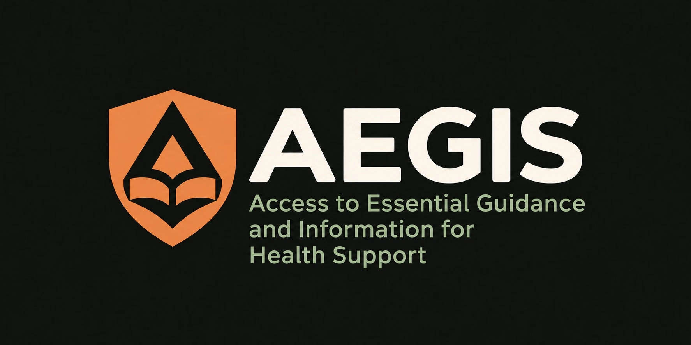

# AEGIS

**A conexão cai. O conhecimento permanece.**



Protótipo experimental de biblioteca de conhecimento em saúde **offline-first** para **Raspberry Pi 2**. **Acervo editorial inicial com sete fichas pendentes de revisão profissional — não validado clinicamente.**

## Objetivo
O AEGIS reúne referências em saúde para profissionais que precisam consultar conhecimento mesmo sem acesso à internet. O acervo utiliza documentos oficiais do Ministério da Saúde e literatura científica selecionada, com identificação das fontes, versões e estado de revisão editorial.

A fonte única em `content/editorial.json` gera o catálogo Python/SQLite e o JavaScript local da interface Linux. A leitura gráfica funciona por `file://`, sem servidor, `fetch`, CDN ou rede. O lançador existente usa Chromium/Chrome e uma ponte somente de loopback para as ferramentas opcionais do dispositivo; ela não é necessária para ler as fichas.

**Estado real:** sete fichas na oficina editorial, zero fichas com revisão profissional documentada. A consulta padrão mostra somente revisados; entre explicitamente na oficina para ler os materiais pendentes. Nenhuma data de consulta de fonte representa aprovação clínica.

Site de divulgação (independente do aplicativo): https://aegis-offline.leoulson.chatgpt.site

## Galeria visual

### Hardware de referência — Raspberry Pi 2 Model B


*Representação gráfica do Raspberry Pi 2 Model B, plataforma de referência do AEGIS. Esta imagem é ilustrativa, não uma fotografia do hardware real nem um modelo CAD.*

### Arquitetura técnica


## Acervo inicial e política editorial

Fichas: avaliação inicial/gravidade, febre, dispneia, dor torácica, desidratação, hipoglicemia e guia da calculadora. Navegação por seis áreas; Saúde da mulher e Procedimentos e segurança estão planejadas, sem fichas. As áreas com material indicam as contagens reais.

Há busca por título, tema, palavras-chave, bibliografia e texto, filtros de área/estado, leitura com fontes e limitações, e política editorial offline. Os PDFs e artigos completos não são distribuídos: as fichas contêm sínteses próprias, referências e condições de reprodução verificadas ou explicitamente pendentes.

Veja [fontes, direitos, fluxo de revisão e geração do acervo](docs/acervo-editorial.md).

## Gerar e consultar no terminal

Requer Python 3 com SQLite. Não há dependência de rede no uso:

```bash
python3 tools/build-catalog.py
python3 tools/build-catalog.py --check
python3 -m aegis init
python3 -m aegis search gravidade --include-pending
python3 -m aegis read editorial:avaliacao-inicial --include-pending
python3 -m aegis policy
python3 -m unittest discover -s tests -v
```

Sem `--include-pending`, fichas não revisadas ficam fora da busca/leitura editorial. Banco padrão: `~/.local/share/aegis/library.sqlite3`; use `--db /caminho/banco.sqlite3` antes do comando para uma cópia de teste. A importação substitui somente a tabela gerenciada de fichas, preservando documentos pessoais/legados. O antigo `content/demo.json` permanece como fixture legada, sem aprovação clínica presumida.

## Interface Linux e calculadora recuperadas

**ZIP histórico (não contém este acervo nem é pacote assinado do atualizador):** [AEGIS-Linux-atualizado.zip](https://github.com/leoulson/AEGIS/raw/refs/heads/main/downloads/AEGIS-Linux-atualizado.zip). Inclui a interface, o lançador, a calculadora, os guias e os testes. Extraia em uma nova pasta para conferir; o download não substitui automaticamente a instalação existente na VM.

Os arquivos locais da conversa “Editar Linux проекта” foram acrescentados em [`aegis-linux/`](aegis-linux/LEIA-ME.md), preservando a biblioteca de terminal existente:

- Interface demonstrativa offline com pesquisa, filtros e salvos temporários.
- Lançador Python, janela própria/tela cheia, instalação por usuário e XDG Autostart após login.
- Botão **Calculadora**: dose prescrita em mg/dose, mg/kg/dose ou mg/kg/dia e conversão para mL conforme concentração informada.
- Cadastro já implementado de paracetamol e ibuprofeno (MSF) e cetirizina (NHS), com fonte, datas, precauções e bloqueios de escopo/limites. Nenhuma dose foi acrescentada ou alterada nesta publicação.

Para visualizar, abra `aegis-linux/app/index.html`. No Linux com sessão gráfica, Python 3.9+ e Chromium/Chrome:

```bash
python3 aegis-linux/aegis.py --check
python3 aegis-linux/aegis.py
```

Instalação e início após login: consulte o [guia Linux](aegis-linux/LEIA-ME.md). A opção `--install` recusa substituir uma instalação existente; baixar esta versão não atualiza automaticamente a cópia instalada.

O alvo continua sendo Raspberry Pi 2 / Raspberry Pi OS de 32 bits. A conversa registra o protótipo anterior funcionando no Debian da VM; esta publicação foi verificada no Windows. **Não foram lidos nem copiados arquivos internos da VM**, nem aplicada esta atualização nela. O funcionamento no Pi 2 físico continua pendente.

Veja [validação e procedência](aegis-linux/VALIDACAO.md) e [manifesto dos arquivos recuperados](docs/linux-source-manifest.json).

## Central de atualizações do aplicativo

O novo lançador acrescenta **Configurações → Atualizações**, com consulta a Releases
estáveis, pacotes locais assinados, preparação separada e restauração. A interface
continua no Chromium da tela do dispositivo; a ponte Python atende somente ao loopback.
A instalação requer uma chave pública confiável provisionada separadamente.
O ZIP antigo não é compatível. Veja o [guia completo](docs/atualizacoes.md) para
a primeira instalação, assinatura, publicação, limites e testes.

## Ferramentas offline do dispositivo

Configurações inclui diagnóstico real, verificação do acervo, backup/recuperação
independente, acessibilidade e atalhos persistentes. Veja o
[guia das ferramentas](docs/ferramentas-dispositivo.md) para acessar cada função,
testar em instalação isolada e conferir os limites e o roteiro no Raspberry Pi 2.

## Estrutura
```text
aegis/           aplicação de terminal
aegis-linux/     protótipo gráfico, lançador e calculadora offline
content/         fonte editorial única, catálogo gerado e fixture legada
docs/assets/     identidade visual, arquitetura e imagem do Raspberry Pi 2
tests/           testes automatizados
```

## Limites e próximos passos
Não estão implementados: imagem Linux customizada, leitor de documentos pessoais do SQLite na interface gráfica, rede Wi-Fi local, mapas offline, bateria, sincronização, IA generativa, aprovação clínica do acervo ou arquivo CAD imprimível. As duas interfaces compartilham agora o catálogo editorial; isso não é um portal remoto nem validação profissional. Os próximos passos são testar em Raspberry Pi 2 físico, medir desempenho e alimentação, construir um projeto mecânico dimensionado e definir processo de curadoria e licenciamento da literatura.

**Aviso:** biblioteca demonstrativa e calculadora experimental para conferência aritmética, com referências internacionais que exigem revisão profissional antes de uso clínico. O AEGIS não é dispositivo médico, não oferece diagnóstico, triagem ou prescrição. Materiais clínicos futuros exigem avaliação e atualização editorial.

Código sob licença MIT. Elementos visuais são conceituais.
