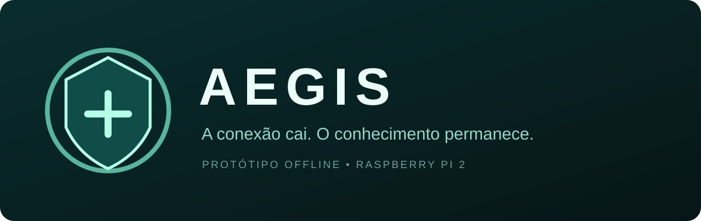
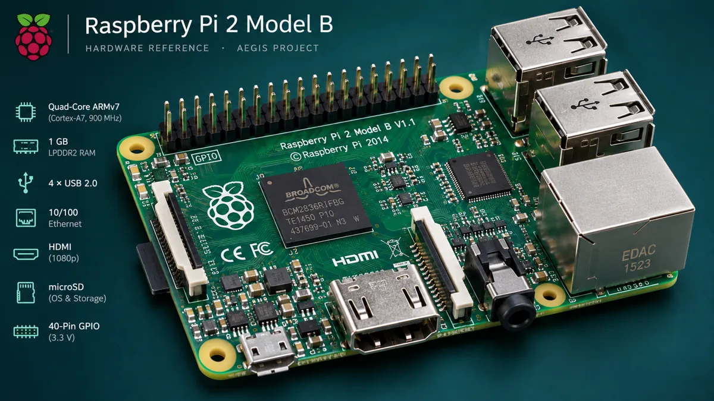
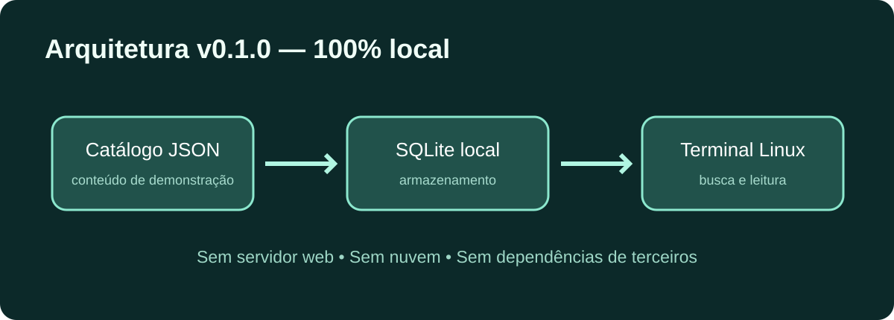

# AEGIS

**A conexão cai. O conhecimento permanece.**



Protótipo experimental de biblioteca de conhecimento em saúde **offline-first** para **Raspberry Pi 2**. **Protótipo de terminal v0.1.0 + interface Linux com calculadora — não validado clinicamente.**

## Objetivo
Preservar localmente acesso a materiais educativos e referências em saúde em contextos de conectividade instável. A biblioteca de terminal usa Python e SQLite. O protótipo gráfico em `aegis-linux/` usa Chromium/Chrome para abrir arquivos locais, sem servidor web nem dependência de nuvem durante o uso. As duas interfaces ainda não compartilham o acervo.

Site de divulgação (independente do aplicativo): https://aegis-offline.leoulson.chatgpt.site

## Galeria visual

### Hardware de referência — Raspberry Pi 2 Model B


*Representação gráfica do Raspberry Pi 2 Model B, plataforma de referência do AEGIS. Esta imagem é ilustrativa, não uma fotografia do hardware real nem um modelo CAD.*

### Arquitetura técnica


## Funcionalidades da versão 0.1.0
- Importar catálogo JSON local para SQLite.
- Buscar documentos por título, categoria ou texto.
- Ler conteúdo pelo terminal sem conexão à internet.
- Executar testes automatizados com a biblioteca padrão Python.

## Executar no Raspberry Pi 2 ou Linux
Requer Python 3 com módulo SQLite (biblioteca padrão).

```bash
git clone https://github.com/leoulson/AEGIS.git
cd AEGIS
python3 -m aegis init
python3 -m aegis search offline
python3 -m aegis read welcome
python3 -m unittest discover -s tests -v
```

Banco padrão: `~/.local/share/aegis/library.sqlite3`. Opcionalmente, use `python3 -m aegis --db /caminho/banco.sqlite3 init`. Somente o clone inicial precisa da internet.

## Interface Linux e calculadora recuperadas

**Pacote para download:** [AEGIS-Linux-atualizado.zip](https://github.com/leoulson/AEGIS/raw/refs/heads/main/downloads/AEGIS-Linux-atualizado.zip). Inclui a interface, o lançador, a calculadora, os guias e os testes. Extraia em uma nova pasta para conferir; o download não substitui automaticamente a instalação existente na VM.

Os arquivos locais da conversa “Editar Linux проекта” foram acrescentados em [`aegis-linux/`](aegis-linux/LEIA-ME.md), preservando a biblioteca de terminal existente:

- Interface demonstrativa offline com pesquisa, filtros e salvos temporários.
- Lançador Python, janela própria/tela cheia, instalação por usuário e XDG Autostart após login.
- Botão **Calculadora**: dose prescrita em mg/dose, mg/kg/dose ou mg/kg/dia e conversão para mL conforme concentração informada.
- Cadastro já implementado de paracetamol e ibuprofeno (MSF) e cetirizina (NHS), com fonte, datas, precauções e bloqueios de escopo/limites. Nenhuma dose foi acrescentada ou alterada nesta publicação.

Para visualizar, abra `aegis-linux/app/index.html`. No Linux com sessão gráfica, Python 3.9+ e Chromium/Chrome:

```bash
python3 aegis-linux/aegis.py --check
python3 aegis-linux/aegis.py
```

Instalação e início após login: consulte o [guia Linux](aegis-linux/LEIA-ME.md). A opção `--install` recusa substituir uma instalação existente; baixar esta versão não atualiza automaticamente a cópia instalada.

O alvo continua sendo Raspberry Pi 2 / Raspberry Pi OS de 32 bits. A conversa registra o protótipo anterior funcionando no Debian da VM; esta publicação foi verificada no Windows. **Não foram lidos nem copiados arquivos internos da VM**, nem aplicada esta atualização nela. O funcionamento no Pi 2 físico continua pendente.

Veja [validação e procedência](aegis-linux/VALIDACAO.md) e [manifesto dos arquivos recuperados](docs/linux-source-manifest.json).

## Estrutura
```text
aegis/           aplicação de terminal
aegis-linux/     protótipo gráfico, lançador e calculadora offline
content/         dados demonstrativos
docs/assets/     identidade visual, arquitetura e imagem do Raspberry Pi 2
tests/           testes automatizados
```

## Limites e próximos passos
Não estão implementados: imagem Linux customizada, integração do acervo SQLite com a interface gráfica, rede Wi-Fi local, mapas offline, bateria, sincronização, recursos de IA, biblioteca clínica curada ou arquivo CAD imprimível. Os próximos passos são testar em Raspberry Pi 2 físico, medir desempenho e alimentação, construir um projeto mecânico dimensionado e definir processo de curadoria e licenciamento da literatura.

**Aviso:** biblioteca demonstrativa e calculadora experimental para conferência aritmética, com referências internacionais que exigem revisão profissional antes de uso clínico. O AEGIS não é dispositivo médico, não oferece diagnóstico, triagem ou prescrição. Materiais clínicos futuros exigem avaliação e atualização editorial.

Código sob licença MIT. Elementos visuais são conceituais.
